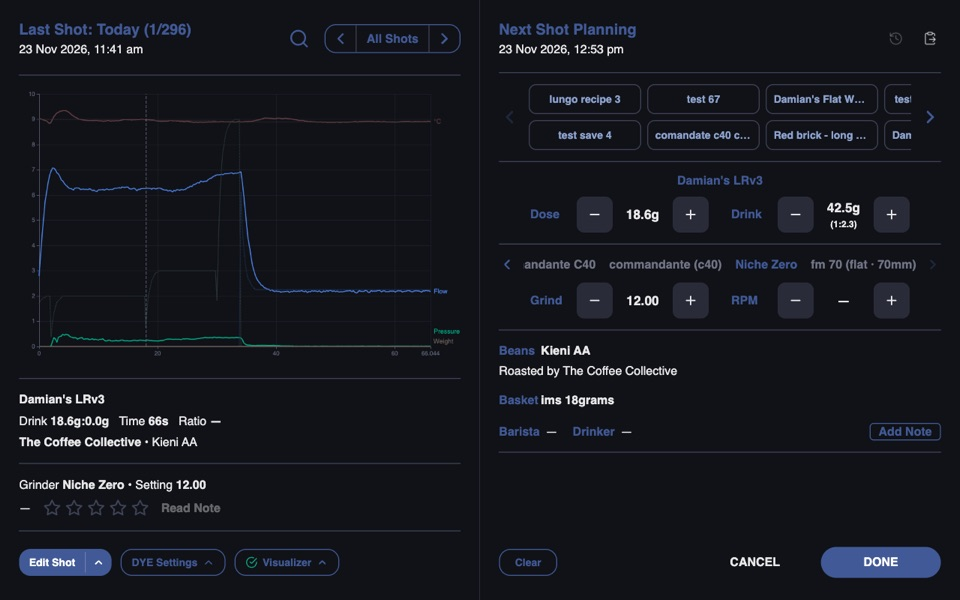
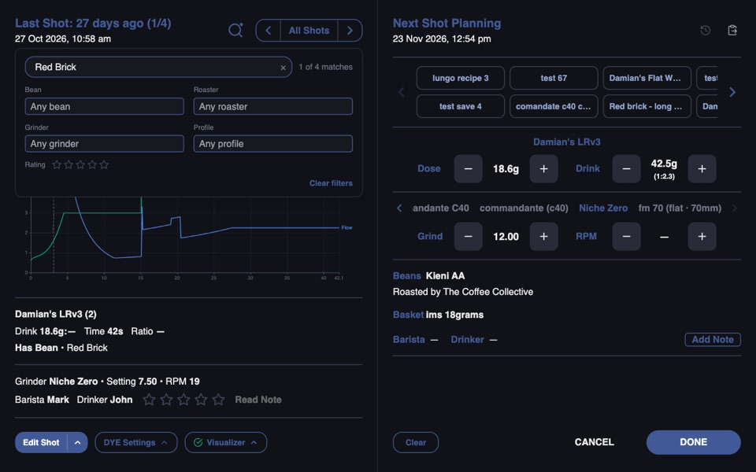
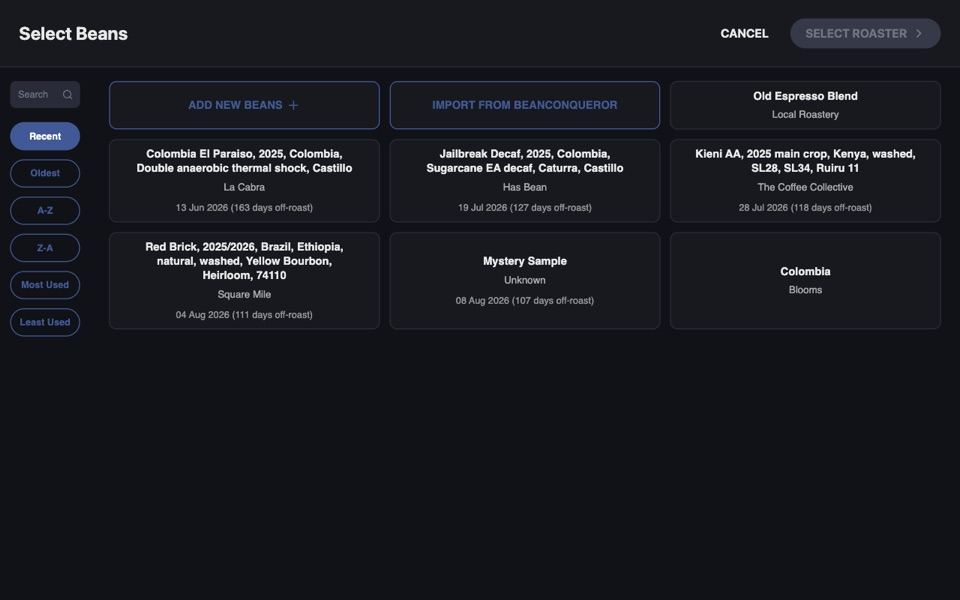
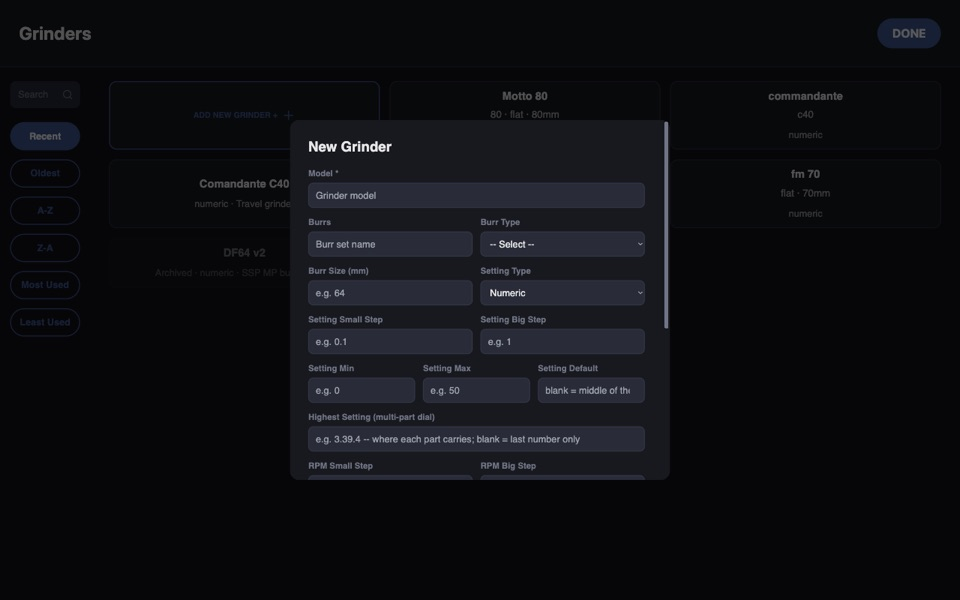
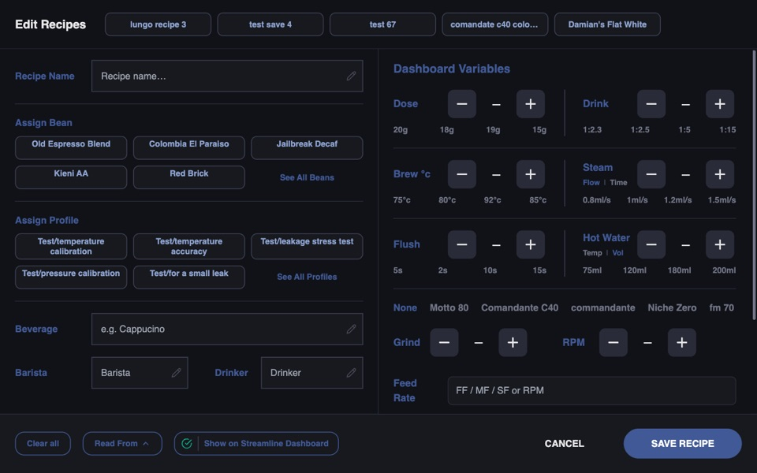
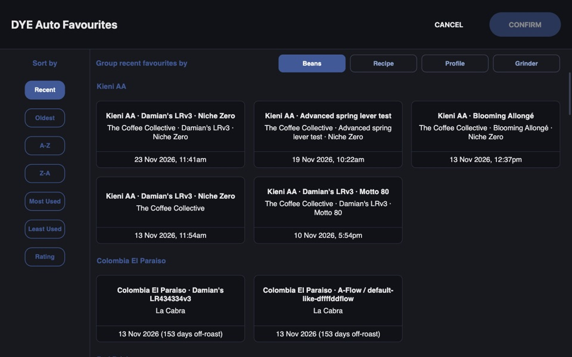
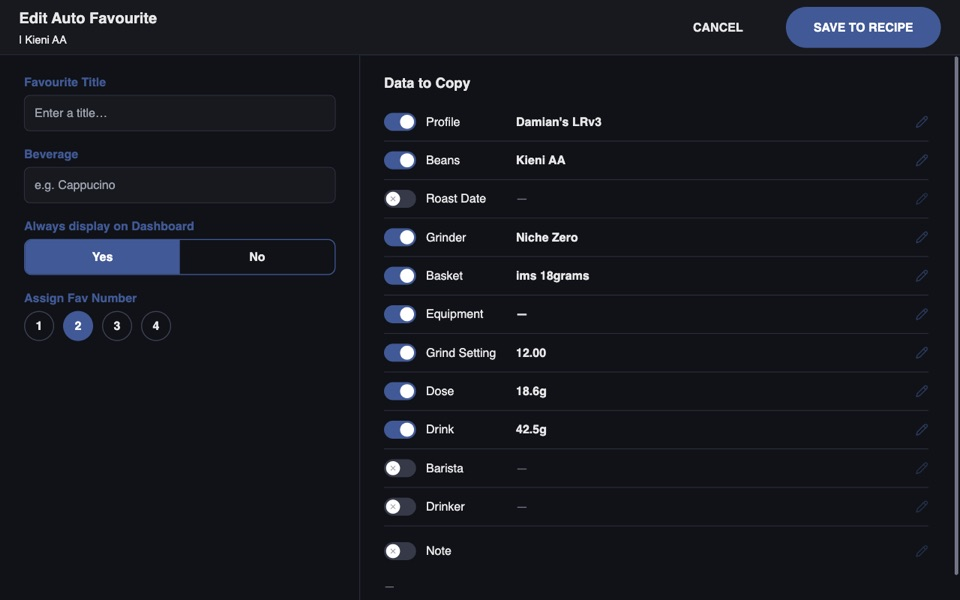
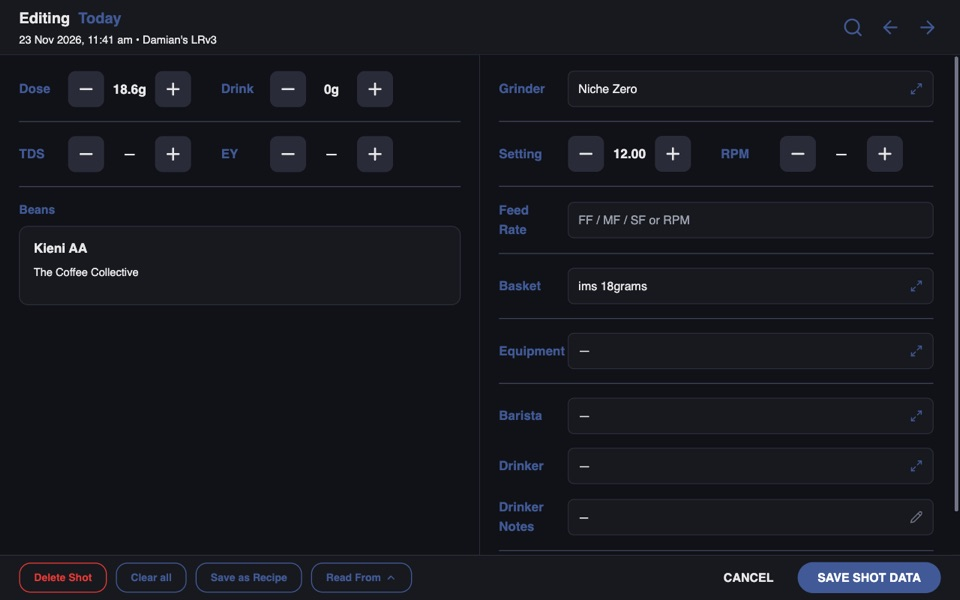

# DYE2 User Manual

DYE2 ("Describe Your Espresso") is an add-on for **Decaid**, the tablet software on your
Decent Espresso machine. It helps you keep track of your coffee: what beans you used, how
you ground them, how the shot went, and how to repeat a shot you loved.

You don't need any technical knowledge to use it. Start with **"Your first five minutes"**,
then jump to **"How do I…?"** whenever you want to do something specific.

---

## Contents

1. [What DYE2 can do](#what-dye2-can-do)
2. [Getting DYE2 on the tablet](#getting-dye2-on-the-tablet)
3. [Your first five minutes](#your-first-five-minutes)
4. [The dashboard](#the-dashboard)
5. [How do I…?](#how-do-i)
6. [Your coffee library](#your-coffee-library)
7. [Grinders, baskets and other equipment](#grinders-baskets-and-other-equipment)
8. [Recipes](#recipes)
9. [Favourites](#favourites)
10. [Editing a shot you already pulled](#editing-a-shot-you-already-pulled)
11. [Importing from Beanconqueror](#importing-from-beanconqueror)
12. [Visualizer](#visualizer)
13. [Handy habits](#handy-habits)
14. [Things that don't work yet](#things-that-dont-work-yet)
15. [Glossary](#glossary)

---

## What DYE2 can do

- **Look back at any shot.** See the graph, the numbers and the coffee you used, and give
  it a star rating.
- **Find old shots fast.** Search by coffee, roaster, grinder, profile or rating.
- **Plan your next shot.** Set the dose, drink weight, grind, RPM, profile, beans, basket,
  barista and drinker, all from one screen.
- **Save recipes.** Keep your favourite drinks as recipes and load one with a single tap.
- **Get automatic favourites.** DYE2 watches your shot history and suggests the
  coffee + profile + grinder combinations you use and rate the most.
- **Keep libraries** of your coffees (with each bag you buy), your grinders, your baskets
  and any other equipment (scales, WDT tools…).
- **Bring your data over from Beanconqueror.**
- **Send shots to Visualizer** (visualizer.coffee), if you also have the Visualizer plugin.

Everything you enter is stored by Decaid itself, not hidden inside DYE2, so other Decaid
screens see the same beans, shots and grinders.

---

## Getting DYE2 on the tablet

Most people already have it: Decaid ships with DYE2 built in. Just switch it on in Decaid's
plugin settings.

If you want a specific version, download `dye2.reaplugin-vX.Y.Z.zip` from the
[Releases page](../../releases) and install it in Decaid's plugin settings with the **+**
button in the top-right corner.

Once it's on, open the DYE2 **Dashboard**. Every other DYE2 screen is reached from there. If
a screen ever asks for its address, it is:

```
http://localhost:8080/api/v1/plugins/dye2.reaplugin/dashboard
```

The screens are made for a tablet held sideways (landscape). They also work in a normal web
browser on a laptop, if you'd like to look around there first.

---

## Your first five minutes

1. **Add your grinder.** On the dashboard, tap the word **Grind** (the blue label, not the
   number) → **ADD NEW GRINDER +** → type the model → **SAVE**.
2. **Add your coffee.** Tap the **Beans** line on the dashboard → **ADD NEW BEANS** → type the
   bean name and roaster (both are required) → **CONFIRM**.
3. **Pick a profile.** Tap the profile name in the middle of the right half.
4. **Set dose, drink and grind** with the **−** and **+** buttons.
5. **Pull your shot** on the machine as usual.
6. **Rate it.** Back on the dashboard, tap a star on the left. That's it — it's saved.

After a few shots, DYE2 starts suggesting **favourites** for you, and you can save the
setups you like as **recipes**.

---

## The dashboard



The dashboard is split down the middle:

- **Left half = a shot you already pulled.**
- **Right half = the shot you're about to pull.**

### Left: Last Shot

| What you see | What it does |
| --- | --- |
| `Last Shot: Today (1/296)` and a date | Which shot you're looking at and where it sits in your history (here: the newest of 296). |
| The graph | How the shot went: pressure (green), flow (blue), temperature (red) and weight. Dotted lines show what the profile *asked for*; solid lines show what really happened. |
| `‹` and `›` | Step to older (`‹`) and newer (`›`) shots. Your whole history is reachable; older shots load as you get to them, so there may be a short pause now and then. Going past the oldest shot loops back to the newest. |
| The magnifying glass | Opens the **shot search** (see "…find an old shot"). A small dot appears on it while a search is active. |
| `All Shots` / `Same Beans` | Switches between every shot and only the shots made with the same coffee as the one on screen. **The button shows the mode you are in now.** |
| Profile, drink, time, ratio, beans, grinder, barista, drinker | A read-only summary of that shot. To change any of it, use `Edit Shot`. |
| The five stars | Tap one to rate the shot. **It saves straight away.** |
| `Read Note` | Shows the note saved with that shot. Greyed out if there's no note. |
| `Edit Shot` | Opens the full shot editor. |
| The `⌃` beside `Edit Shot` | A small menu with `Delete Shot` (asks first, **cannot be undone**). |
| `DYE Settings ⌃` | Opens **Favourites**, **Recipes** or **Equipment**. |
| `Visualizer ⌃` | `Upload to Visualizer` and `Visualizer Settings`. A green tick means you're logged in. |

### Right: Next Shot Planning

Everything here goes into Decaid's live settings — the ones the machine will use for your
next shot.

| What you see | What it does |
| --- | --- |
| Recipe buttons (top rows) | All your saved recipes. Tap one to load it. Use `‹ ›` to scroll if you have many. |
| Profile name | Tap to choose a different profile. |
| `Dose` / `Drink` | Grams of coffee in / grams of espresso out. The brew ratio (e.g. `1:2.3`) shows under the drink. `−`/`+` move dose by 0.5 g and drink by 1 g, or **tap the number and type**. |
| Row of grinder names | Tap a grinder to use it for the next shot. If that grinder has a default setting or RPM saved, those are filled in too. |
| The word `Grind` | Tap the **label** to open your grinder library. |
| `Grind` / `RPM` | Your grind setting and the grinder's speed. `−`/`+` move grind by 0.1 and RPM by 1. If your grinder has a minimum and maximum saved, the buttons stay inside that range. |
| `Beans` | The coffee and its roaster. Tap to pick another coffee. |
| `Basket` | The filter basket. Tap to pick another basket. |
| `Barista` / `Drinker` | Tap and type a name. Names you've used before appear in a list underneath. |
| `Add Note` | A note for the **next** shot. After you pull it, `Read Note` on the left shows it. |
| History icon (top right) | **Undo.** Puts back the values you had before your last change. Tap again to redo. |
| Clipboard icon (top right) | **Copy the shot on the left** into this panel — the quickest way to repeat a shot. |
| `Clear` | Empties the panel. |
| `CANCEL` / `DONE` | Both leave the dashboard. `DONE` saves first. |

**What saves when?**

- **Saved immediately:** dose, drink, grind, RPM, grinder, barista, drinker, the note, a
  recipe button, and a favourite you apply.
- **Waits for `DONE`:** the **clipboard copy** and **Clear**. They only change the screen. If
  you leave with `CANCEL`, they are thrown away and nothing on the machine changes.

---

## How do I…?

### …rate the shot I just pulled
Open the dashboard and tap a star on the left. It saves itself. To add a written note, tap
`Edit Shot`.

### …pull the same shot again
Find the shot on the left (with `‹ ›` or the search), tap the **clipboard icon** on the
right, then press **DONE**.

### …change dose, drink, grind or RPM
Use `−` / `+`, or tap the number and type a new one. **Enter** accepts, **Escape** cancels.
Tapping somewhere else also accepts what you typed.

### …use a different profile
Tap the profile name on the right. You get a grid of profiles with a search box and sort
buttons (`A-Z`, `Z-A`, `Recent`, `Oldest`). Tap a profile, then **CONFIRM**. `Read more` on a
card shows its full description.

### …use a different coffee
Tap **Beans** on the right. Tap a coffee (it turns blue), then the button in the top right:

- It says **CONFIRM** if the coffee already has a roaster — you're done.
- It says **SELECT ROASTER** if not — pick the roaster on the next screen, then tap
  **SELECT ROASTER** again.

The coffee, roaster, roast date and bag all go into your next shot.

### …change the basket
Tap **Basket** on the right, pick one, **CONFIRM**. **ADD NEW BASKET +** creates a new one.

### …find an old shot



Tap the **magnifying glass** on the left.

- **Type** anything — a coffee, roaster, profile, grinder or words from your notes. The left
  side jumps to the first match and shows e.g. "1 of 4 matches". Use `‹ ›` to step through
  the matches.
- **Narrow it down** with the boxes below: **Bean**, **Roaster**, **Grinder**, **Profile** and
  a minimum **Rating**. They all work together.
- The **×** in the search box clears the text; **Clear filters** clears everything.
- Tapping the glass again (or pressing Escape) **hides** the search box but **keeps the
  search on** — the little dot on the glass reminds you. To see all shots again, open it and
  tap **Clear filters**.

The search asks the machine directly, so it finds shots from months ago instantly.

### …see only shots with this coffee
Tap **All Shots** so it changes to **Same Beans**. Tap again to go back.

### …save what I'm drinking as a recipe
See [Recipes](#recipes). The quickest way: open the shot in `Edit Shot` and tap **Save as
Recipe**.

---

## Your coffee library



Tap **Beans** on the dashboard to see all your coffees. Each card shows the coffee, the
roaster, and the roast date with how many days ago that was.

- **Search box** and **sort buttons** (`Recent`, `Oldest`, `A-Z`, `Z-A`) on the left.
- **Pencil** on a card: edit that coffee instead of selecting it.
- **ADD NEW BEANS**: add a coffee.
- **IMPORT FROM BEANCONQUEROR**: see [Importing from Beanconqueror](#importing-from-beanconqueror).

### Adding a coffee
The form is one long page you scroll through:

- **Top** — bean name, roaster, roast date. Name and roaster suggest ones you already have.
- **Origin** — species, processing, country, region, producer, variety, altitude, and a
  decaf switch (turning it on shows a decaf-process box).
- **Roast & Batch Details** — roast level, harvest date, quality score, frozen switch.
- **Purchase & Storage** — price, total and remaining weight, and dates for buying, opening,
  best-before, freezing and unfreezing.
- **Notes** — notes about the coffee in general, and about this particular bag.

**Bean name and roaster are required.** If one is empty, its box turns red and `CONFIRM`
won't save. Everything else is optional.

### Coffees and bags
DYE2 keeps one entry per **coffee**, plus one **batch** for each **bag** you buy. Buy the same
coffee twice and you get one coffee with two batches, each with its own roast date and weight.

### Roasters
On the roaster screen there's no search box. To add a new roaster, add a coffee with that
roaster's name on it (**ADD NEW ROASTER +** opens the add-a-coffee form).

---

## Grinders, baskets and other equipment

### Grinders



Open the grinder library by tapping the word **Grind** on the dashboard. Tap a card to edit
it, or **ADD NEW GRINDER +**. **DONE** takes you back.

A grinder records:

- **Model** (the only required field), burrs, burr type (flat or conical), burr size.
- **Setting type** — *Numeric* (a dial with numbers) or *Preset* (named steps). For preset
  grinders, list the step names separated by commas.
- **Setting Min / Max / Default** — the lowest and highest setting, and where you usually
  start. The dashboard's `−`/`+` buttons won't go past min or max, and picking this grinder on
  the dashboard fills in the default. Leave default blank to use the middle of the range.
- **Highest Setting (multi-part dial)** — only for grinders whose setting has several parts,
  like `1.12.4`. Enter the highest reading (for example `3.39.4`) and `−`/`+` will roll over
  correctly (`1.12.4` → `1.13.0`).
- **RPM Min / Max / Default** — the same idea for grinder speed.
- **Step sizes** — recorded on the grinder; the dashboard still moves grind by 0.1 and RPM
  by 1.
- **Notes.**

A greyed-out card marked **Archived** is a grinder you've retired. It stays for old shots but
is out of the way.

### Baskets
Reach them by tapping **Basket** on the dashboard. A basket has a name (required), size
(single, double, bottomless…), diameter and notes.

### Other equipment
`DYE Settings ⌃ → Equipment`. Anything else you use — a scale, a WDT tool, a puck screen.
Give it a name, then **+ Add field** to create your own fields (for example "circle: 2").
In `Edit Shot`, the **Equipment** box lets you attach these to a shot and fill in the values
for that shot.

---

## Recipes

A **recipe** is a complete setup — coffee, profile, dose, drink, grind and more — that you
can load in one tap.

### Choosing a recipe
`DYE Settings ⌃ → Recipes` opens **Select Recipe**.

- **Tap** a card to select it, then **CONFIRM** to load it.
- **Tap the selected card again** (or press and hold) to **edit** it.
- **ADD NEW RECIPE +** creates one.
- Sort by `Recent`, `Oldest`, `A-Z`, `Z-A`, `Most Used`, `Least Used` or `Rating` (the
  average stars of shots made with that recipe).

You can also just tap a recipe button at the top of the dashboard.

**Loading a recipe doesn't lock you in.** Change the dose or grind afterwards and the recipe
itself stays as it was. When you've dialled in something you want to keep, long-press that
recipe's button on the Streamline strip and choose **Save changes** — only the values you
actually changed are written to the recipe.

### Editing a recipe



- **Left side** — recipe name, the coffee (**Assign Bean**; `See All Beans` for the full
  list), the profile (**Assign Profile**; `See All Profiles`), beverage, barista and drinker.
- **Right side ("Dashboard Variables")** — dose, drink, brew temperature, steam, flush, hot
  water, grinder, grind, RPM, feed rate, basket and equipment.
- **Machine Settings** (tap to open, at the bottom on the right) — steam temperature, milk
  stop temperature, hot water time and flow, flush temperature and flow. These are the same
  settings as on Streamline's settings page.
- Under most numbers is a row of **quick-pick chips**. Tap one to jump to that value. Press
  and hold a chip for half a second to change it to the current number (this only lasts until
  you leave the page).

**Most of it fills itself in.** Pick a profile and the dose, drink and brew temperature are
taken from it.

### The five recipe buttons on Streamline
The five buttons along the top of the recipe editor match the **five recipe buttons on the
Streamline strip**. Each shows which recipe holds that spot now.

- Tap one to put **this** recipe on that spot. If another recipe already has it, tap
  **SAVE RECIPE** twice to confirm.
- Tap the highlighted one again to take this recipe **off** the strip. It stays in your
  library.

### Buttons at the bottom
- **Clear all** — empty the form.
- **Read From ⌃** — fill the form from the **Current Workflow** (what's on the dashboard now)
  or **From Favourite** (pick one of your favourites).
- **Show on Streamline Dashboard** — turn off to hide this recipe from the Streamline strip.
  It still shows on the DYE2 dashboard.
- **CANCEL** / **SAVE RECIPE**.

---

## Favourites



**You don't have to create favourites — DYE2 makes them for you.** It looks at your recent
shots and picks out the coffee + profile + grinder combinations you use and rate highly.
Recent, well-rated combinations rank highest; ones you haven't used for about two months drop
off.

`DYE Settings ⌃ → Favourites` shows them.

- The tabs at the top group them by **Beans**, **Recipe**, **Profile** or **Grinder**.
- Sort buttons on the left: `Recent`, `Oldest`, `A-Z`, `Z-A`, `Rating`.
- **Tap** a card, then **CONFIRM** — the favourite's coffee, profile, grinder, grind, dose and
  drink are loaded into your next shot, and you return to the dashboard.
- **Press and hold** a card for half a second to open it for editing.

### Turning a favourite into a recipe



In the editor, **Data to Copy** lists everything the favourite holds: profile, beans, roast
date, grinder, basket, equipment, grind setting, dose, drink, barista, drinker and note.

- Each row has a **switch**. Only switched-on rows are copied.
- The **pencil** at the end of a row lets you type that value yourself.
- Give it a **title** and a **beverage**, then tap **SAVE TO RECIPE**. A **new recipe** is
  created in your recipe library; the favourite itself isn't changed.

---

## Editing a shot you already pulled



Tap `Edit Shot` on the dashboard.

- **Left** — dose, drink, TDS and extraction yield (EY), and the coffee (tap it to change it).
- **Right** — grinder, grind setting, RPM, feed rate, basket, equipment, barista, drinker,
  drinker notes (tap the pencil to write) and the star rating.
- `‹ ›` in the top right move to another shot. Unlike the dashboard, they stop at the ends.

Along the bottom:

- **Delete Shot** — removes it after asking. **Cannot be undone.**
- **Clear all** — empties the form.
- **Save as Recipe** — opens the recipe editor filled in from this shot.
- **Read From ⌃** — fill the form from the **Current Workflow** or the **Previous Shot**, so
  you only fix what's different.
- **CANCEL** / **SAVE SHOT DATA**.

**Nothing here is saved until you tap `SAVE SHOT DATA`** — including the stars. (On the
dashboard, stars save straight away.)

---

## Importing from Beanconqueror

DYE2 can read a Beanconqueror backup and create your coffees, bags and grinders.

1. In **Beanconqueror** on your phone: `Settings → Export`. You get a zip file.
2. Unzip it and find **`Beanconqueror.json`** (big exports may also have
   `Beanconqueror_Beans_0.json`).
3. In DYE2: tap **Beans** → **IMPORT FROM BEANCONQUEROR**.
4. Tap **CHOOSE FILE** and pick the file, **or** paste its text into the big box. (Pasting is
   more reliable on the tablet.)
5. The right side shows what *would* happen: how many new coffees, bags and grinders, and
   which coffees would only get empty fields filled in. Nothing is saved yet.
6. Happy? Tap **IMPORT** and watch the progress.

Good to know:

- **Your own typing is safe.** For coffees you already have, only empty fields are filled.
- **Bags are refreshed.** A bag imported before is updated from the new export — except
  "remaining weight", which the tablet keeps counting down as you pull shots.
- **Run it again any time.** It matches what's already there instead of making duplicates.
- Baskets, drippers and other preparation gear are stored for reference only.

---

## Visualizer

DYE2 works with Decaid's separate **Visualizer plugin**, which must be installed.

1. `Visualizer ⌃ → Visualizer Settings`.
2. Type your visualizer.coffee username and password and save. DYE2 checks them first and
   tells you if they're wrong.
3. **Auto-upload starts switched on**, skipping shots shorter than 5 seconds (so flushes
   aren't uploaded). Turn it off here if you'd rather upload by hand.

Once logged in, the **Visualizer** button shows a green tick, and `Upload to Visualizer` sends
the shot currently shown on the left.

Two quirks: the settings box always opens showing auto-upload on and 5 seconds, whatever you
saved last time; and saving again while logged in asks for your password again.

---

## Handy habits

- **Tap a number to type it.** Much faster than holding `+` when you're far off.
- **Long press means "edit"** on favourites and recipes, and "rewrite" on recipe chips.
- **The undo button toggles.** Press it twice and you're back where you started.
- **Use search instead of tapping `‹` fifty times.**
- **Rate your shots.** Stars decide which favourites DYE2 suggests and power the `Rating`
  sort.
- **`DONE` is save-and-leave**, but most of the panel has already saved as you went.

---

## Things that don't work yet

These are shown on screen but don't do anything yet — you're not doing it wrong:

- The **magnifying glass in the shot editor** (the dashboard one works).
- **Export Shot** and **View Text Profile** in the `Edit Shot ⌃` menu.
- **Most Used** / **Least Used** sorting for coffees, grinders and favourites (they work for
  recipes). Coffees and grinders fall back to A-Z; favourites keep their order.
- In the favourite editor, **Always display on Dashboard** and **Assign Fav Number** aren't
  saved. Favourites place themselves on the strip automatically.

---

## Glossary

| Word | What it means here |
| --- | --- |
| **Batch** | One bag of a coffee. The same coffee bought twice = one coffee, two batches. |
| **Profile** | The machine's plan for pressure, flow and temperature during a shot. You pick one in DYE2; you build them elsewhere in Decaid. |
| **Workflow** | Decaid's word for the settings the next shot will use — the right half of the dashboard. |
| **Dose / Drink** | Grams of ground coffee in / grams of espresso out. |
| **Brew ratio** | Drink ÷ dose. 18 g in, 40 g out ≈ 1:2.2. |
| **RPM** | How fast your grinder's burrs turn, if your grinder lets you set it. |
| **Feed rate** | How fast beans go into the grinder, for grinders that let you control it. |
| **TDS / EY** | Total dissolved solids (measured with a refractometer) and extraction yield. Optional. |
| **Recipe** | A saved full setup you can load in one tap. |
| **Favourite** | A setup DYE2 suggests automatically from your best recent shots. |
| **Archived** | A grinder or basket you no longer use. Kept for old shots, shown greyed out. |
| **Visualizer** | visualizer.coffee, a website for storing and comparing shots. |
| **Decaid** | The tablet software DYE2 plugs into (formerly ReaPrime / Streamline). |
